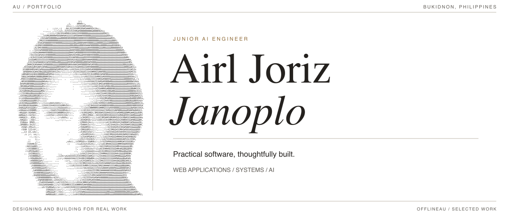

<picture>
  <source media="(prefers-color-scheme: dark)" srcset="github-profile/masthead-dark.png">
  <source media="(prefers-color-scheme: light)" srcset="github-profile/masthead-light1.png">
  
</picture>

**Junior AI Engineer** based in Bukidnon, Philippines. I build practical web applications, from school management modules to student well-being platforms.

[Selected work](#selected-work) &nbsp; / &nbsp; [Toolkit](#toolkit) &nbsp; / &nbsp; [GitHub activity](#github-activity) &nbsp; / &nbsp; [LinkedIn](https://www.linkedin.com/in/airljoriz-dev/) &nbsp; / &nbsp; [Email](mailto:janoplo.airljoriz@gmail.com)

I’m Au. My work spans **frontend interfaces, backend services, database integrations, and RESTful APIs**. I use JavaScript, TypeScript, PHP, and Python, with experience in React, Laravel, and FastAPI.

I’ve worked on Human Resource, Payroll, Finance, Student, Principal and Registrar portals for a school management system. I also spearheaded **Sentisphere**, building frontend and backend components, integrating the database, and documenting the architecture and workflows.

**Currently focused on** school management workflows, reliable interfaces and APIs, and stronger system analysis and documentation.

<table>
  <tr>
    <td width="50%" valign="top">01 &nbsp; / &nbsp; WEB + MOBILE &nbsp; / &nbsp; 2024–26<h3><a href="https://github.com/offlineAu/Sentisphere">Sentisphere ↗</a></h3>
A sentiment analysis system for monitoring student emotional health, bringing web and mobile experiences together with NLP services.

Laravel / React / FastAPI / Hugging Face / Expo
</td>
    <td width="50%" valign="top">02 &nbsp; / &nbsp; WEB APPLICATION<h3><a href="https://github.com/offlineAu/Veloce-Dev">Veloce ↗</a></h3>
A client-acquisition platform connecting a service website, personalized referrals, and a structured lead pipeline.

Next.js / TypeScript / Prisma / PostgreSQL
</td>
  </tr>
  <tr>
    <td width="50%" valign="top">03 &nbsp; / &nbsp; MOBILE APPLICATION<h3><a href="https://github.com/offlineAu/E-Lista">E-Lista ↗</a></h3>
A neighborhood-store app connecting shopper ordering with owner pricing, restocking, and fulfillment. Development uses Firebase emulators.

Flutter / Dart / Firebase / TypeScript
</td>
    <td width="50%" valign="top">04 &nbsp; / &nbsp; AUTOMATION &nbsp; / &nbsp; CHED REGION X<h3><a href="https://github.com/offlineAu/IssuanceSubsystem">Issuance Subsystem ↗</a></h3>
An internal administration subsystem for issuance, processing, and reporting workflows.

Google Apps Script / BigQuery / JavaScript
</td>
  </tr>
</table>

<strong>Inside Sentisphere: how the pieces fit together</strong>

 

The web application uses **Laravel and React**, with a **FastAPI** service for transformer-based sentiment analysis. A **React Native and Expo** companion app supports student check-ins. My work covered frontend and backend components, database integration, and architectural and workflow documentation.

[Explore the Sentisphere repository](https://github.com/offlineAu/Sentisphere)

<strong>View two more projects</strong>

 

**[LOOM](https://github.com/offlineAu/loom)** — A mobile-first tracker platform focused on a shared design system, tracker discovery, and a reusable application shell. `Next.js` `React` `TypeScript`

**[Syntax.sip](https://github.com/offlineAu/mobile-syntax-sip)** — A mobile coffee-shop prototype with welcome and account flows. `React Native` `Expo`

**Frontend & mobile**  
    

**Backend & data**  
    

**AI & workflow**  
   

Also working on system analysis, API integration, and architecture documentation.

**Contribution calendar** · The past year

<a href="https://github.com/offlineAu#contribution-activity">
  <picture>
    <source media="(prefers-color-scheme: dark)" srcset="https://ghchart.xqsit94.in/dark:halloween/offlineAu">
    
  </picture>
</a>

Select the calendar to explore the contribution history on GitHub.

**Contribution streak**

<picture>
  <source media="(prefers-color-scheme: dark)" srcset="https://streak-stats.demolab.com/?user=offlineAu&amp;theme=dark&amp;hide_border=true&amp;background=00000000&amp;ring=c8a96e&amp;fire=c8a96e&amp;currStreakLabel=c8a96e">
  <source media="(prefers-color-scheme: light)" srcset="https://streak-stats.demolab.com/?user=offlineAu&amp;theme=default&amp;hide_border=true&amp;background=FFFFFF00&amp;ring=967341&amp;fire=967341&amp;currStreakLabel=967341">
  
</picture>

---

AU / BUKIDNON, PHILIPPINES &nbsp;&nbsp; — &nbsp;&nbsp; OPEN TO FULL-STACK DEVELOPMENT OPPORTUNITIES
